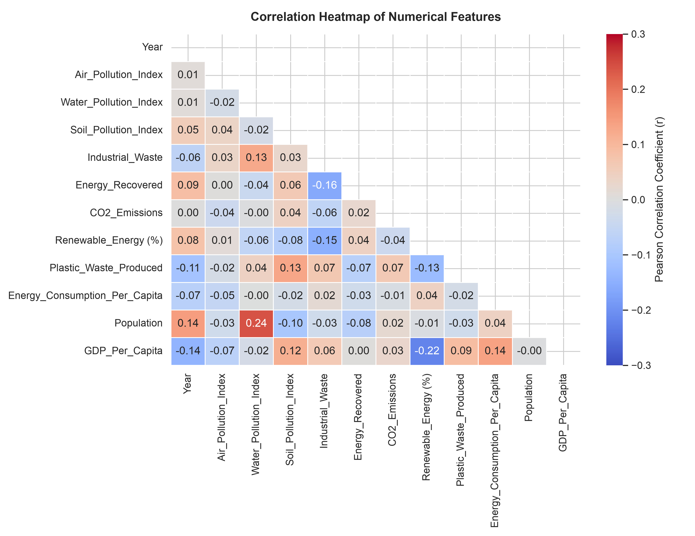
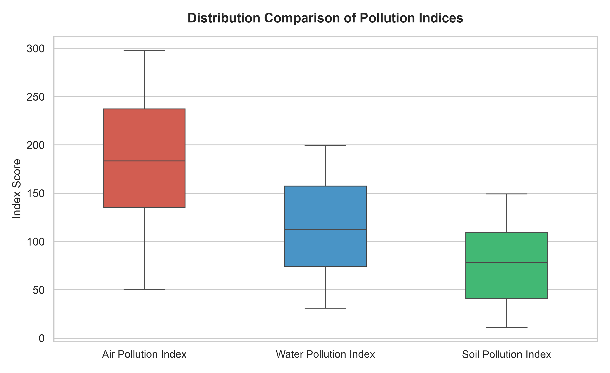
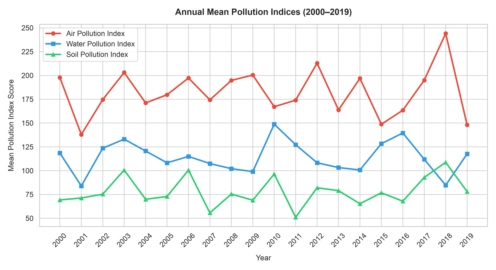
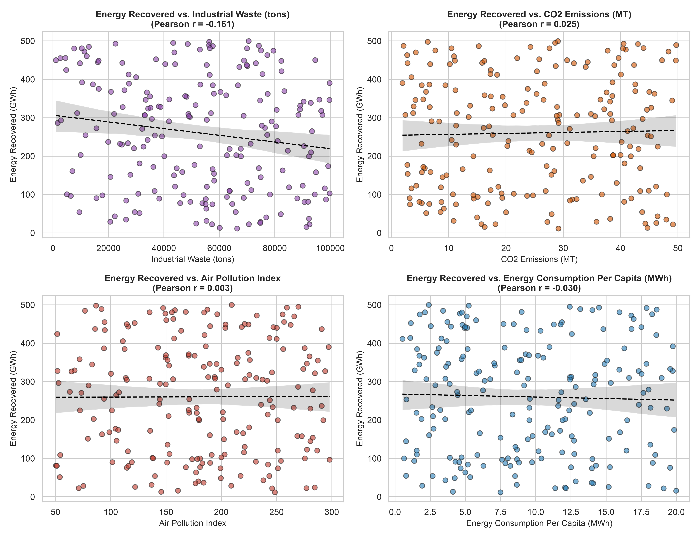
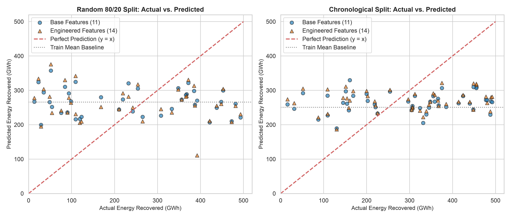
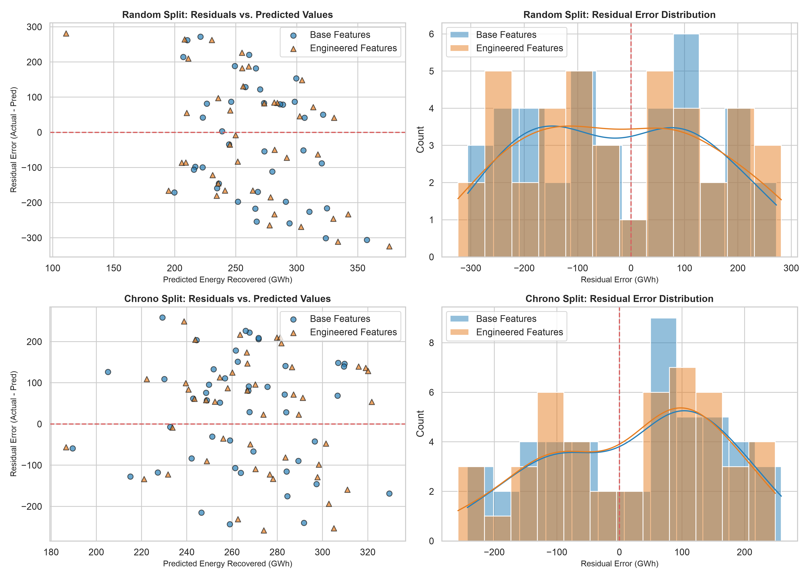
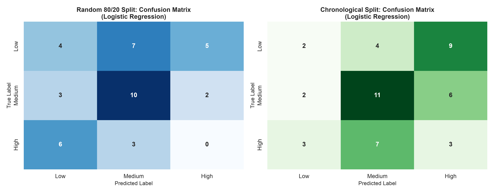
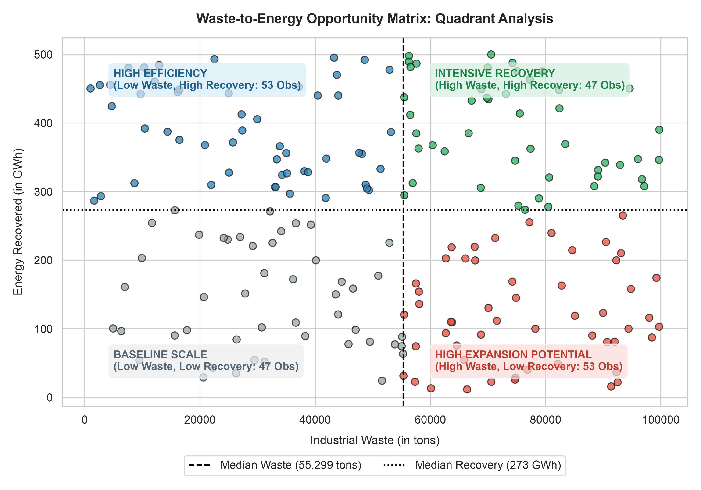

# Global Pollution Analysis and Energy Recovery

An empirical machine learning and exploratory data analysis project examining global pollution indices, industrial emissions, waste metrics, and waste-to-energy recovery across 175 countries (2000–2019).

---

## 1. Project Overview

This repository contains an end-to-end data science study analyzing global environmental and industrial indicators. The project explores the structural relationships between multi-media pollution indices (air, water, and soil), industrial waste generation, and energy recovery, and benchmarks classical machine learning models for continuous prediction and multiclass severity classification.

The workflow emphasizes rigorous methodology: strict prevention of target leakage, disciplined feature engineering with unit verification, dual train/test evaluation (random cross-sectional vs. chronological out-of-time), transparent benchmark comparison against baseline heuristics, and honest reporting of model limitations.

---

## 2. Problem Statement and Objectives

1. **Exploratory Data Analysis & Integrity Audit:** Investigate the distributional characteristics, missing values, duplicates, and anomalies across country-level environmental records.
2. **Regression (Energy Recovery Prediction):** Model and predict `Energy_Recovered (in GWh)` using industrial waste, emissions, and macroeconomic covariates using Linear Regression, benchmarking against a dummy mean baseline.
3. **Classification (Pollution Severity Classification):** Categorize ambient air pollution severity into **Low**, **Medium**, and **High** classes based on training-set tertiles, strictly excluding the source index from predictors to eliminate target leakage, and evaluate Multiclass Logistic Regression against a majority-class baseline.
4. **Generalization Analysis:** Compare standard random 80/20 partitioning against a chronological train/test split (2000–2014 vs. 2015–2019) to assess out-of-time forecasting performance under temporal drift.

---

## 3. Dataset Description

* **Source:** [Google Drive Dataset Link](https://drive.google.com/file/d/1AEMcCWzJ24fc26Q761SEOa1sOsZiJBC5/view?usp=sharing)
* **Local Path:** `data/raw/Global_Pollution_Analysis.csv`
* **Dimensions:** 200 observations, 13 attributes.
* **Coverage:** 175 unique countries spanning the years 2000 to 2019 (~5 to 15 records per year).

### Features & Target Variables

| Column Name | Data Type | Description & Units | Role |
| :--- | :--- | :--- | :--- |
| `Country` | Object | Country name (175 unique nations; 152 appear once) | Entity Identifier (Excluded from predictors) |
| `Year` | Int64 | Observation year (2000 to 2019) | Numerical Covariate |
| `Air_Pollution_Index` | Float64 | Ambient air quality score ($50.30 - 297.95$) | Predictor (Reg) / Target Generator (Clf) |
| `Water_Pollution_Index` | Float64 | Water contamination metric ($31.13 - 199.32$) | Numerical Predictor |
| `Soil_Pollution_Index` | Float64 | Soil degradation score ($11.15 - 149.23$) | Numerical Predictor |
| `Industrial_Waste (in tons)` | Float64 | Annual industrial waste generated ($1,019.37 - 99,739.36$) | Numerical Predictor |
| `CO2_Emissions (in MT)` | Float64 | Carbon dioxide emissions in megatons ($1.92 - 49.69$) | Numerical Predictor |
| `Renewable_Energy (%)` | Float64 | Renewable energy share of total consumption ($5.04\% - 49.56\%$) | Numerical Predictor |
| `Plastic_Waste_Produced (in tons)` | Float64 | Annual plastic waste production ($542.95 - 49,852.28$) | Numerical Predictor |
| `Energy_Consumption_Per_Capita (in MWh)` | Float64 | Energy use per person in megawatt-hours ($0.53 - 19.98$) | Numerical Predictor |
| `Population (in millions)` | Float64 | National population in millions ($2.32 - 198.82$) | Numerical Predictor |
| `GDP_Per_Capita (in USD)` | Float64 | Gross domestic product per capita ($1,298.70 - 69,143.14$) | Numerical Predictor |
| `Energy_Recovered (in GWh)` | Float64 | Energy harvested from waste in gigawatt-hours ($11.73 - 499.98$) | **Regression Target Variable** |

---

## 4. Repository Structure

```
Global-Pollution-Analysis/
├── data/
│   └── raw/
│       └── Global_Pollution_Analysis.csv       # Raw immutable dataset
├── notebooks/
│   └── main.ipynb                              # Executed Jupyter notebook (Phases 1-4)
├── outputs/
│   └── visualizations/                         # Persisted high-resolution visual artifacts
│       ├── classification_confusion_matrices.png
│       ├── correlation_heatmap.png
│       ├── country_pollution_comparison.png
│       ├── energy_recovery_distribution.png
│       ├── energy_recovery_potential_quadrants.png
│       ├── energy_recovery_relationships.png
│       ├── industrial_waste_distribution.png
│       ├── pollution_boxplots.png
│       ├── pollution_trends_over_time.png
│       ├── regression_actual_vs_predicted.png
│       └── regression_residuals.png
├── .gitignore                                  # Git exclusion configuration
├── README.md                                   # Comprehensive project documentation
└── requirements.txt                            # Minimal verified python dependencies
```

---

## 5. Technologies and Libraries Used

* **Python 3.13**
* **Pandas (>=2.2.0):** Data structures, cleaning, and aggregation.
* **NumPy (>=2.0.0):** Numerical transformations and vector operations.
* **Scikit-Learn (>=1.5.0):** Modeling pipelines, preprocessing scalers, linear/logistic models, and evaluation metrics.
* **Matplotlib (>=3.9.0) & Seaborn (>=0.13.0):** Publication-quality data visualizations and diagnostic plots.
* **Jupyter & IPyKernel:** Interactive notebook execution and reproducible research.

---

## 6. Data Preprocessing and Feature Engineering

### Data Cleaning & Anomaly Audit
* **Missing Values:** Exactly 0 missing or unrecorded entries across all 13 columns.
* **Duplicate Rows:** Exactly 0 full-row duplicate records.
* **The Spain 2004 Duplicate Key Anomaly:** The compound key `(Spain, 2004)` appears twice in the dataset (Row Indices 147 and 179). A column-by-column audit revealed that every numerical attribute differed substantially (Population: $105.76\text{M}$ vs. $145.99\text{M}$; GDP/capita: $\$49,171$ vs. $\$26,353$; Industrial Waste: $29,481$ vs. $88,457$ tons; Energy Recovered: $54.68$ vs. $307.91\text{ GWh}$). Neither entry matches historical Spanish demographics ($43.5\text{M}$ population). To avoid unverified assumptions, both observations were preserved initially to maintain raw sample size ($N=200$).
* **Country Cardinality Handling:** `Country` contains 175 categories across 200 records (152 countries appear only once). One-hot encoding would introduce 174 sparse dummy columns, causing severe overfitting and zero out-of-sample generalization. `Country` was therefore treated strictly as an observational entity identifier and excluded from model inputs.

### Feature Engineering
1. **Total Energy Consumption (`Energy_Consumption_Total_GWh`):**
   Derived using verified physical unit conversion:
   $$\text{Total GWh} = \text{Energy\_Consumption\_Per\_Capita} \left(\frac{\text{MWh}}{\text{person}}\right) \times (\text{Population} \times 10^6 \text{ persons}) \times \left(\frac{1\text{ GWh}}{1000\text{ MWh}}\right)$$
   $$\text{Energy\_Consumption\_Total\_GWh} = \text{Energy\_Consumption\_Per\_Capita (MWh)} \times \text{Population (millions)} \times 1000$$
   *Note: Because this is a deterministic mathematical product of two existing columns, it introduces aggregate national scale but no external independent information.*
2. **Per-Capita Waste Metrics (`Industrial_Waste_Per_Capita_kg`, `Plastic_Waste_Per_Capita_kg`):**
   Derived after verifying that denominators contain no zero values ($\min(\text{Population}) = 2.32\text{M}$):
   $$\text{Industrial\_Waste\_Per\_Capita\_kg} = \frac{\text{Industrial\_Waste (tons)}}{\text{Population (millions)} \times 1000}$$
   $$\text{Plastic\_Waste\_Per\_Capita\_kg} = \frac{\text{Plastic\_Waste\_Produced (tons)}}{\text{Population (millions)} \times 1000}$$
3. **Discipline:** Arbitrary pollution-to-waste ratios were avoided to prevent unstable divisions and non-physical artifacts.

---

## 7. Exploratory Data Analysis Findings

1. **Correlation Matrix:**
   `Energy_Recovered (in GWh)` exhibits very low linear correlation with all candidate predictors: Industrial Waste ($r = -0.161$), Year ($r = +0.088$), Soil Pollution ($r = +0.064$), Renewable Energy ($r = +0.044$), CO2 Emissions ($r = +0.025$), Air Pollution ($r = +0.003$), and Per Capita Energy Consumption ($r = -0.030$). No pair of predictors exhibits collinearity ($|r| < 0.24$).

   

2. **Pollution Distributions & Scales:**
   Air, water, and soil pollution indices operate on distinct scales without Tukey outliers ($> 1.5 \times \text{IQR}$).

   

3. **Temporal Trajectories (2000–2019):**
   Annual averages oscillate in stable bands (Air: $155 - 205$; Water: $95 - 135$; Soil: $65 - 90$) without monotonic global trends. Annual variations reflect changing cross-sectional country composition rather than synchronized global environmental cycles.

   

4. **Target Bivariate Scatter Analysis:**
   OLS trendlines of energy recovery against industrial waste, emissions, air pollution, and energy consumption demonstrate flat slopes, indicating no bivariate linear dominance.

   

---

## 8. Predictive Modeling Methodology and Actual Results

### Model 1: Linear Regression (Energy Recovery Prediction)
* **Target:** `Energy_Recovered (in GWh)`
* **Preprocessors:** `StandardScaler` fitted strictly on training data inside `Pipeline`.
* **Feature Sets:**
  * **Base (11 features):** All raw numerical predictors.
  * **Engineered (14 features):** Base features + `Energy_Consumption_Total_GWh`, `Industrial_Waste_Per_Capita_kg`, `Plastic_Waste_Per_Capita_kg`.
* **Baseline:** `DummyRegressor(strategy='mean')`.

#### Empirical Regression Metrics

| Evaluation Strategy | Model | MAE (GWh) | MSE | RMSE (GWh) | $R^2$ Score |
| :--- | :--- | :--- | :--- | :--- | :--- |
| **Random 80/20 Split** | **Dummy Baseline (Train Mean)** | **141.65** | **24,879.62** | **157.73** | **-0.029** |
| (Train: 160, Test: 40) | Linear Regression (Base Features) | 145.98 | 27,715.08 | 166.48 | -0.146 |
| | Linear Regression (Engineered Features) | 150.25 | 29,986.72 | 173.17 | -0.240 |
| **Chronological Split** | **Dummy Baseline (Train Mean)** | 125.36 | 20,259.57 | 142.34 | -0.093 |
| (Train: 153, Test: 47) | Linear Regression (Base Features) | 121.41 | 18,918.33 | 137.54 | -0.021 |
| | Linear Regression (Engineered Features) | **120.53** | **18,761.32** | **136.97** | **-0.012** |

#### Diagnostic Visualizations




* **Analytical Interpretation:**
  * In the **Random Split**, Linear Regression yielded negative test $R^2$ ($-0.146$ for base, $-0.240$ for engineered), performing worse than predicting the training mean.
  * In the **Chronological Split**, the test set (2015–2019) experienced a temporal mean shift ($292.23\text{ GWh}$ vs. $250.69\text{ GWh}$ in training). Linear regression leveraged the positive slope of `Year` to slightly reduce test RMSE ($136.97$ vs. $142.34$ baseline), but overall $R^2$ remained negative ($-0.012$).
  * **Feature Engineering Impact:** Adding collinear derived features increased model parameter variance, increasing test error in the random split without delivering meaningful out-of-sample improvements.

---

### Model 2: Multiclass Logistic Regression (Pollution Severity Classification)
* **Target:** `Pollution_Severity` (Low, Medium, High).
* **Threshold Definition:** Derived **strictly from training-set tertiles** of `Air_Pollution_Index` ($Q_{33.3\%}$ and $Q_{66.7\%}$):
  * Random Train Cutoffs: $\text{Low} \le 151.36 < \text{Medium} \le 221.09 < \text{High}$
  * Chronological Train Cutoffs: $\text{Low} \le 150.06 < \text{Medium} \le 219.89 < \text{High}$
  * *Important Note: These classes are dataset-relative empirical tertiles, not regulatory or medical air quality standards.*
* **Anti-Leakage Protocol:** `Air_Pollution_Index` was **strictly excluded from all classification predictors** ($X_{\text{clf}}$, 13 features).
* **Baseline:** `DummyClassifier(strategy='most_frequent')`.
* **Model:** `LogisticRegression(max_iter=1000, random_state=42)` scaled via `StandardScaler` fitted on training data.

#### Empirical Classification Metrics

| Evaluation Strategy | Model | Accuracy | Macro Precision | Macro Recall | Macro F1 | ROC-AUC (OVR) |
| :--- | :--- | :--- | :--- | :--- | :--- | :--- |
| **Random 80/20 Split** | **Dummy Baseline (Most Frequent)** | **40.0%** | **0.133** | **0.333** | **0.190** | — |
| (Train: 160, Test: 40) | Multiclass Logistic Regression | 35.0% | 0.269 | 0.306 | 0.282 | 0.458 |
| **Chronological Split** | **Dummy Baseline (Most Frequent)** | 27.7% | 0.092 | 0.333 | 0.144 | — |
| (Train: 153, Test: 47) | Multiclass Logistic Regression | **34.0%** | **0.317** | **0.314** | **0.304** | **0.497** |

#### Confusion Matrix Visualizations



* **Analytical Interpretation:**
  * For a balanced 3-class problem, chance accuracy is $33.3\%$.
  * Logistic Regression achieved **$34.0\% - 35.0\%$ accuracy** and a **One-vs-Rest ROC-AUC of $0.458 - 0.497$**, operating near random guessing.
  * In the random split, the model completely failed on the High class (recall = 0.00). In the chronological split, recall was low for the Low class ($0.13$) and precision low for the High class ($0.17$).
  * **Why is performance modest?** Because our protocol strictly excluded `Air_Pollution_Index` to prevent target leakage. Auxiliary macroeconomic and waste indicators have near-zero correlation with air pollution, leaving no separable linear boundary. Including `Air_Pollution_Index` would have created an artificial $100\%$ accuracy; transparently reporting near-random performance verifies pipeline integrity.

---

## 9. Key Findings & Data Insights

1. **Non-Causality:** Statistical associations do not imply causal mechanisms. High industrial waste generation does not automatically cause higher energy recovery.
2. **Waste-to-Energy Quadrant Analysis:** A transparent, data-based quadrant analysis (High Industrial Waste $> \text{median}$, Low Energy Recovered $< \text{median}$) identifies **53 country-year records** that possess high waste feedstock alongside below-average energy conversion, highlighting potential expansion opportunities.

   

3. **Temporal Split Realism:** Chronological partitioning revealed temporal mean shifts ($+41.5\text{ GWh}$), demonstrating that out-of-time evaluation is crucial for testing realistic forecasting capability.

---

## 10. Limitations

* **Sample Size ($N=200$):** High metric variance due to limited sample size.
* **Country Cardinality:** 175 unique countries across 200 rows prevented country-specific longitudinal modeling.
* **Spain 2004 Collision:** Discrepancy highlights potential data collection or provenance inconsistencies.
* **Null Linear Performance:** Neither linear regression nor logistic classification outperformed heuristic baselines.
* **Model Maturity:** These linear models are **not production-ready** and are presented strictly as transparent educational benchmarks.

---

## 11. Recommendations and Future Work

### Evidence-Based Recommendations
1. **Transition to Continuous Panels:** Environmental research bodies should collect balanced panel datasets (fixed cohorts observed annually) rather than sparse cross-sections.
2. **Document Data Provenance:** Collection agencies should specify whether observations reflect national accounts, regional samples, or municipal surveys.
3. **Capture Plant-Level Operational Indicators:** Future waste-to-energy modeling must include facility-level metrics (incinerator thermal capacity, anaerobic digestion plants, tipping fees) rather than broad ambient pollution indices.
4. **Collect High-Resolution Meteorological Data:** Air quality severity modeling requires localized wind speed, temperature inversions, and point-source emissions data.

### Future Improvements
* **Dataset Expansion:** Prioritize assembling verified datasets ($N > 2,000$ with continuous country-year coverage) before exploring complex non-linear architectures (e.g., gradient boosted trees).
* **Waste Stream Disaggregation:** Separate industrial waste into combustible vs. recyclable vs. inert components.

---

## 12. Setup and Execution Instructions

### Prerequisites
* Python 3.13 (or $\ge 3.10$)
* Git

### Local Installation
```bash
# Clone repository
git clone <repo-url>
cd Global-Pollution-Analysis

# Create and activate virtual environment
python3 -m venv .venv
source .venv/bin/activate

# Install minimal verified dependencies
pip install -r requirements.txt
```

### Running the Notebook
```bash
# Launch Jupyter Notebook
jupyter notebook notebooks/main.ipynb

# Or execute top-to-bottom headlessly via nbconvert
jupyter nbconvert --to notebook --execute --inplace notebooks/main.ipynb
```
